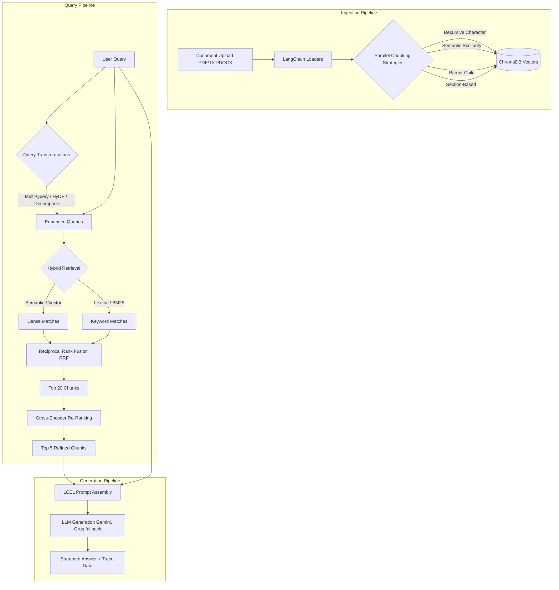

# RAGForge AI: Production-Grade Advanced RAG

This repository contains the completed **Advanced RAG with LangChain**. It is a full-stack, production-ready Retrieval-Augmented Generation platform built to address the limitations of basic RAG systems by implementing hybrid search, cross-encoder re-ranking, advanced chunking strategies, and automated evaluation.

---

## Architecture Diagram

The system is built on a dual-pipeline architecture: Ingestion and Querying.



---

## Setup & Installation

### Prerequisites
- Python **3.11–3.12 recommended** (3.13/3.14 may work; production images use 3.12)
- Node.js 18+
- `uv` or `pip`

### 1. Backend (development)
```bash
cd backend
python -m venv .venv
# Windows: .venv\Scripts\activate
# macOS/Linux: source .venv/bin/activate
pip install -r requirements.txt
```

Copy env defaults and set secrets:
```bash
cp ../.env.example ../.env
# Set GOOGLE_API_KEY (primary), GROQ_API_KEY (fallback) and a strong JWT_SECRET_KEY
# LLM_PROVIDER=gemini, LLM_FALLBACK_PROVIDER=groq — if Gemini errors, Groq answers instead
```

Start the API:
```bash
uvicorn app.main:app --reload --port 8000
```

In **development**, shared sample documents are auto-seeded when none exist. You can also click **Samples** in the UI or call:
```bash
curl -X POST http://localhost:8000/api/documents/ingest-samples
```
Sample docs are **shared** (`user_id` null) so every signed-in account can query them.

### 2. Frontend (development)
```bash
cd frontend
cp .env.example .env.local
npm install
npm run dev
```
Open **[http://localhost:3000](http://localhost:3000)**, sign up, then use the dashboard.

### 3. Tests & lint
```bash
# Backend
cd backend
pytest -q

# Frontend
cd frontend
npm run typecheck
npm run lint
```

### 4. Production (Docker)
Set production values in `.env`:
```env
ENVIRONMENT=production
AUTH_REQUIRED=true
OFFLINE_FALLBACK=false
JWT_SECRET_KEY=<openssl rand -hex 32>
CORS_ORIGINS=https://your-frontend.example
GOOGLE_API_KEY=<your Gemini key>
GROQ_API_KEY=<your Groq key, used as fallback>
NEXT_PUBLIC_API_URL=https://your-api.example/api
```

Then:
```bash
docker compose up --build -d
```

---

## Core API Surface

| Method | Endpoint | Description |
| :--- | :--- | :--- |
| `POST` | `/api/auth/signup` | Create account + JWT |
| `POST` | `/api/auth/login` | Login |
| `POST` | `/api/documents/upload` | Upload & ingest document across all chunk strategies |
| `GET` | `/api/documents` | List own + shared documents |
| `POST` | `/api/documents/ingest-samples` | Seed shared sample corpus |
| `POST` | `/api/query` | Run RAG query |
| `POST` | `/api/query/stream` | Stream pipeline + answer (SSE) |
| `POST` | `/api/query/compare` | A/B test with two strategies |
| `POST` | `/api/evaluate/batch` | Automated evaluation suite |
| `POST` | `/api/contact` | Persist contact form messages (optional SMTP) |
| `GET` | `/api/health` | System health and LLM provider status |

---

## Production checklist

- [ ] `ENVIRONMENT=production`
- [ ] Strong `JWT_SECRET_KEY` (not the placeholder)
- [ ] `AUTH_REQUIRED=true`
- [ ] `OFFLINE_FALLBACK=false` with a real LLM API key
- [ ] Explicit `CORS_ORIGINS` (no `*`)
- [ ] `NEXT_PUBLIC_API_URL` points at the public API
- [ ] Optional SMTP vars if contact form should email you

---

## Project Structure

```text
RAGForge-AI/
├── backend/
│   ├── app/
│   │   ├── routers/
│   │   ├── services/
│   │   ├── models/
│   │   └── data/
│   ├── tests/
│   ├── Dockerfile
│   ├── pyproject.toml
│   └── requirements.txt
├── frontend/
│   ├── src/
│   ├── Dockerfile
│   └── package.json
├── sample_documents/
├── eval_dataset/
├── docker-compose.yml
└── README.md
```
